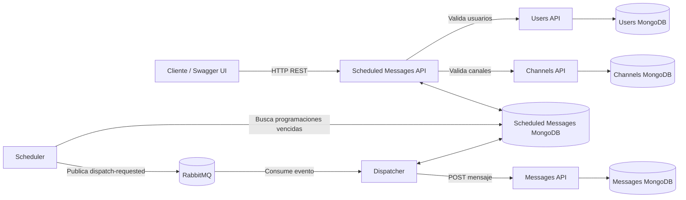

# Microservicio de mensajes programados

Este repositorio extiende el sistema base de chat con la capacidad de **programar mensajes para que sean enviados automáticamente en una fecha y hora futura**.

La solución mantiene separadas las responsabilidades: el nuevo microservicio administra la programación y sus estados, mientras que el servicio base `messages` continúa siendo el único responsable de crear y almacenar los mensajes del chat. La integración se realiza exclusivamente mediante las APIs y eventos publicados; el microservicio no accede a las bases de datos internas de `users`, `channels` ni `messages`.

## Problema que resuelve

En equipos distribuidos, una persona puede redactar un aviso, recordatorio o seguimiento antes del momento en que debe publicarse. Sin esta capacidad, el envío depende de que el autor esté conectado y recuerde hacerlo a la hora correcta.

El servicio permite:

- Crear una programación para un usuario y canal existentes.
- Consultar una programación y su estado.
- Listar programaciones por autor o estado.
- Cancelar una programación que todavía no haya sido procesada.
- Despachar automáticamente el mensaje cuando llega la fecha indicada.
- Reintentar fallos transitorios y registrar fallos definitivos.
- Publicar eventos por cada cambio de estado relevante.

## Arquitectura

El microservicio `scheduled-messages` se ejecuta mediante tres procesos independientes que comparten la misma base de datos:

- **API REST:** recibe, valida, consulta y cancela programaciones.
- **Scheduler:** detecta periódicamente las programaciones cuya hora ya llegó y solicita su despacho.
- **Dispatcher:** consume las solicitudes desde RabbitMQ y utiliza la API REST de `messages` para publicar el mensaje en el chat.



### Patrones de comunicación

| Comunicación | Patrón | Motivo |
|---|---|---|
| Cliente → Scheduled Messages API | REST síncrono | El cliente necesita confirmación inmediata de la operación. |
| Scheduled Messages API → Users API | REST síncrono | Valida que el autor exista antes de aceptar la programación. |
| Scheduled Messages API → Channels API | REST síncrono | Valida que el canal exista antes de aceptar la programación. |
| Scheduler → RabbitMQ | Evento asíncrono | El vencimiento de una programación no bloquea la API ni depende de un cliente conectado. |
| RabbitMQ → Dispatcher | Consumidor asíncrono | Desacopla la detección de la hora del envío efectivo. |
| Dispatcher → Messages API | REST síncrono | `messages` no consume eventos y su contrato público para crear mensajes es HTTP. |

Esta es una integración **híbrida**: el procesamiento interno de las programaciones es asíncrono, pero la creación final se realiza a través del contrato REST publicado por el núcleo del chat.

## Estructura del repositorio

```text
T4_implementacion/
├── docker-compose.yaml
├── README.md
├── users/                       # Servicio base de usuarios
├── channels/                    # Servicio base de canales
├── messages/                    # Servicio base de mensajes
└── scheduled-messages/          # Nueva capacidad vertical
    ├── Dockerfile
    ├── requirements.txt
    └── app/
        ├── main.py              # Configuración de FastAPI y manejo de errores
        ├── api.py               # Operaciones REST versionadas
        ├── schemas.py           # Esquemas de entrada y salida
        ├── service.py           # Reglas de negocio
        ├── scheduler.py         # Detección de programaciones vencidas
        ├── dispatcher.py        # Consumo y envío de mensajes
        ├── event_bus.py         # Publicación y consumo en RabbitMQ
        ├── database.py          # Acceso a MongoDB
        ├── dependencies.py      # Comunicación con el chat base
        ├── errors.py            # Errores del dominio
        └── settings.py          # Configuración por variables de entorno
```

## Tecnologías

- Python y FastAPI para la API REST.
- Pydantic para esquemas y validación.
- MongoDB para programaciones y eventos pendientes.
- RabbitMQ para comunicación asíncrona.
- Docker y Docker Compose para ejecutar el sistema completo.
- OpenAPI/Swagger generado automáticamente por FastAPI.

## Requisitos

- Docker Desktop en ejecución.
- Docker Compose v2, incluido en versiones actuales de Docker Desktop.
- Puertos `8001`, `8002`, `8003`, `8004`, `5672` y `15672` disponibles.

No es necesario instalar Python, MongoDB ni RabbitMQ en el computador anfitrión.

## Ejecución

Desde PowerShell, ubicarse en la raíz del repositorio y levantar todos los contenedores:

```powershell
cd C:\Users\matias\Desktop\T4_implementacion
docker compose up --build
```

Para ejecutarlos en segundo plano:

```powershell
docker compose up --build -d
```

Comprobar el estado de los contenedores:

```powershell
docker compose ps
```

## Servicios disponibles

| Servicio | Dirección |
|---|---|
| Users - Swagger UI | http://localhost:8001/docs |
| Channels - Swagger UI | http://localhost:8002/docs |
| Messages - Swagger UI | http://localhost:8003/docs |
| Scheduled Messages - Swagger UI | http://localhost:8004/docs |
| Scheduled Messages - OpenAPI JSON | http://localhost:8004/openapi.json |
| RabbitMQ Management | http://localhost:15672 |

Las credenciales de RabbitMQ son usuario `chat` y contraseña `chat`.

## API de mensajes programados

La API está versionada bajo el prefijo `/api/v1`.

| Método | Ruta | Descripción |
|---|---|---|
| `GET` | `/health` | Comprueba que la API está activa. |
| `POST` | `/api/v1/scheduled-messages` | Crea una programación. |
| `GET` | `/api/v1/scheduled-messages` | Lista programaciones; permite filtrar por `author_id` y `status`. |
| `GET` | `/api/v1/scheduled-messages/{schedule_id}` | Obtiene una programación por identificador. |
| `DELETE` | `/api/v1/scheduled-messages/{schedule_id}` | Cancela una programación válida. |
| `GET` | `/api/v1/events` | Lista los eventos registrados por el servicio. |

La documentación interactiva, los esquemas, ejemplos y códigos de respuesta se pueden revisar en `http://localhost:8004/docs`.

### Ejemplo de creación

Primero deben existir el usuario y el canal indicados. La fecha debe incluir zona horaria y encontrarse en el futuro.

```json
{
  "author_id": "ID_DEL_USUARIO",
  "channel_id": "ID_DEL_CANAL",
  "content": "Reunión de seguimiento en 10 minutos",
  "scheduled_for": "2026-10-12T18:30:00-03:00"
}
```

Ejemplo de respuesta con estado HTTP `201 Created`:

```json
{
  "id": "ID_DE_LA_PROGRAMACION",
  "author_id": "ID_DEL_USUARIO",
  "channel_id": "ID_DEL_CANAL",
  "content": "Reunión de seguimiento en 10 minutos",
  "scheduled_for": "2026-10-12T21:30:00Z",
  "status": "pending",
  "attempts": 0,
  "message_id": null,
  "last_error": null,
  "next_attempt_at": null,
  "created_at": "2026-10-12T21:20:00Z",
  "updated_at": "2026-10-12T21:20:00Z"
}
```

## Estados de una programación

```text
pending ──► queued ──► processing ──► sent
   │                         │
   ├──► cancelled            ├──► retrying ──► queued
   │                         │
   └─────────────────────────└──► failed
```

| Estado | Significado |
|---|---|
| `pending` | Espera la fecha y hora programadas. |
| `queued` | El scheduler solicitó su despacho en RabbitMQ. |
| `processing` | El dispatcher está intentando crear el mensaje. |
| `retrying` | Ocurrió un fallo transitorio y se programó otro intento. |
| `sent` | El mensaje fue creado correctamente por `messages`. |
| `failed` | No fue posible enviarlo o se agotaron los intentos permitidos. |
| `cancelled` | El usuario canceló la programación antes del envío. |

## Eventos

El servicio usa el exchange durable `chat`, de tipo `topic`. Los eventos de despacho se publican como mensajes persistentes y el dispatcher consume la cola durable `scheduled-message-dispatch`.

| Evento | Momento de emisión |
|---|---|
| `chat.scheduled-message.created` | Se crea una programación. |
| `chat.scheduled-message.cancelled` | Se cancela una programación. |
| `chat.scheduled-message.dispatch-requested` | Llega la hora de envío y el scheduler solicita el despacho. |
| `chat.scheduled-message.processing` | El dispatcher comienza un intento. |
| `chat.scheduled-message.retrying` | Se programa un reintento por un fallo transitorio. |
| `chat.scheduled-message.sent` | `messages` acepta y crea el mensaje. |
| `chat.scheduled-message.failed` | La entrega falla definitivamente. |

Los eventos se guardan primero en una colección de salida (**outbox**) y luego se publican en RabbitMQ. De este modo, si RabbitMQ no está disponible temporalmente, el scheduler puede volver a intentar publicar eventos pendientes.

Ejemplo conceptual de un evento:

```json
{
  "event_id": "UUID_DEL_EVENTO",
  "event_type": "chat.scheduled-message.created",
  "aggregate_id": "ID_DE_LA_PROGRAMACION",
  "occurred_at": "2026-10-12T21:20:00Z",
  "data": {
    "status": "pending"
  }
}
```

Las consultas `GET` no cambian el estado del dominio, por lo que no generan eventos. Sí se emite un evento por cada transacción que crea una programación o modifica su estado.

## Manejo de errores

La API responde errores en formato JSON consistente. Entre los casos contemplados están:

| Código HTTP | Situación |
|---|---|
| `404 Not Found` | La programación solicitada no existe. |
| `409 Conflict` | La programación ya no se encuentra en un estado cancelable. |
| `422 Unprocessable Entity` | Datos inválidos, fecha no futura, usuario inexistente o canal inexistente. |
| `503 Service Unavailable` | No se puede validar una dependencia del chat base. |

FastAPI también expone en OpenAPI los esquemas de entrada, salida y validación.

## Flujo de prueba de punta a punta

Este flujo sirve tanto para comprobar la implementación como para grabar una demostración.

1. Levantar el sistema con `docker compose up --build`.
2. Abrir `http://localhost:8001/docs` y crear un usuario con `POST /api/v1/users`. Guardar el `id` retornado.
3. Abrir `http://localhost:8002/docs` y crear un canal con `POST /api/v1/channels`. Utilizar el usuario cuando el contrato lo solicite y guardar el `id` del canal.
4. Abrir `http://localhost:8004/docs` y ejecutar `POST /api/v1/scheduled-messages` con los identificadores anteriores y una hora aproximadamente uno o dos minutos en el futuro.
5. Consultar `GET /api/v1/scheduled-messages/{schedule_id}`. Inicialmente debe aparecer como `pending`.
6. Esperar hasta la hora configurada y repetir la consulta. El estado debe terminar en `sent` y contener un `message_id`.
7. Abrir `http://localhost:8003/docs` y consultar los mensajes del canal para comprobar que el contenido fue publicado.
8. Ejecutar `GET /api/v1/events` para mostrar los eventos generados durante el flujo.
9. Opcionalmente, abrir RabbitMQ Management en `http://localhost:15672` para mostrar el exchange y la cola.

Para demostrar la cancelación, crear una segunda programación con una hora posterior, ejecutar su operación `DELETE` y comprobar que queda en estado `cancelled` y no se publica en el canal.

## Logs y diagnóstico

Ver los registros de todos los servicios:

```powershell
docker compose logs -f
```

Ver únicamente los tres procesos de la capacidad:

```powershell
docker compose logs -f scheduled-messages-api scheduled-messages-scheduler scheduled-messages-dispatcher
```

## Detener el sistema

Detener y retirar los contenedores, conservando los datos:

```powershell
docker compose down
```

Eliminar también los volúmenes y comenzar nuevamente con bases de datos vacías:

```powershell
docker compose down -v
```

> **Advertencia:** la opción `-v` elimina los datos almacenados por los contenedores.

## Decisiones y consideraciones

- `scheduled-messages` posee su propia base de datos y no comparte colecciones con el chat base.
- La fecha se recibe con zona horaria y se normaliza para evitar ambigüedades.
- El scheduler consulta programaciones vencidas cada dos segundos.
- El dispatcher procesa un mensaje a la vez por consumidor y confirma el evento después de manejarlo.
- Los fallos transitorios pueden reintentarse hasta tres veces, con una espera de diez segundos.
- La actualización atómica del estado evita que dos procesos reclamen la misma programación al mismo tiempo.
- RabbitMQ entrega eventos al menos una vez. El control de estado reduce el riesgo de procesamiento duplicado.
- La operación final depende de la disponibilidad y del contrato público del servicio `messages`.

## Publicación en GitHub

El repositorio debe publicarse sin credenciales, archivos de entorno privados ni datos sensibles. Después de revisar los cambios, el archivo puede agregarse con:

```powershell
git add README.md
git commit -m "docs: agrega documentacion del microservicio"
git push
```

Si todavía no existe un repositorio remoto, se puede crear uno público desde GitHub y asociarlo siguiendo las instrucciones que entrega la plataforma.

